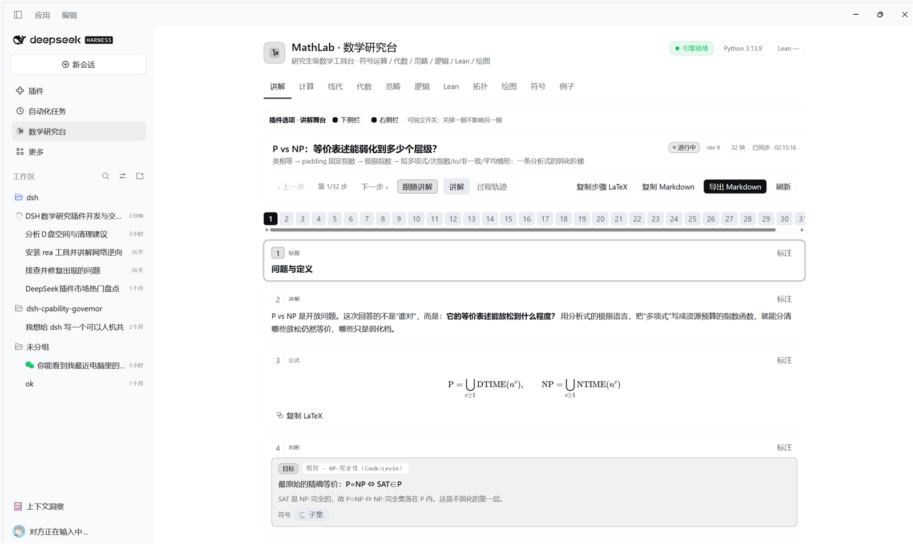
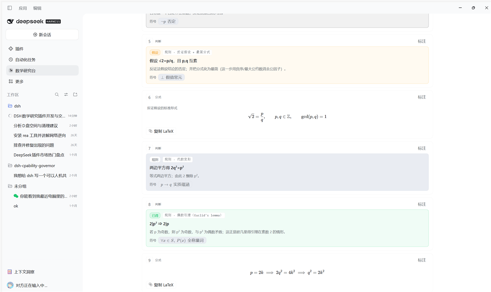
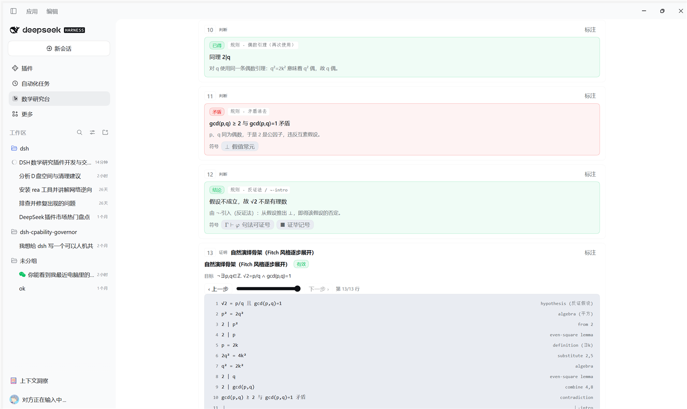
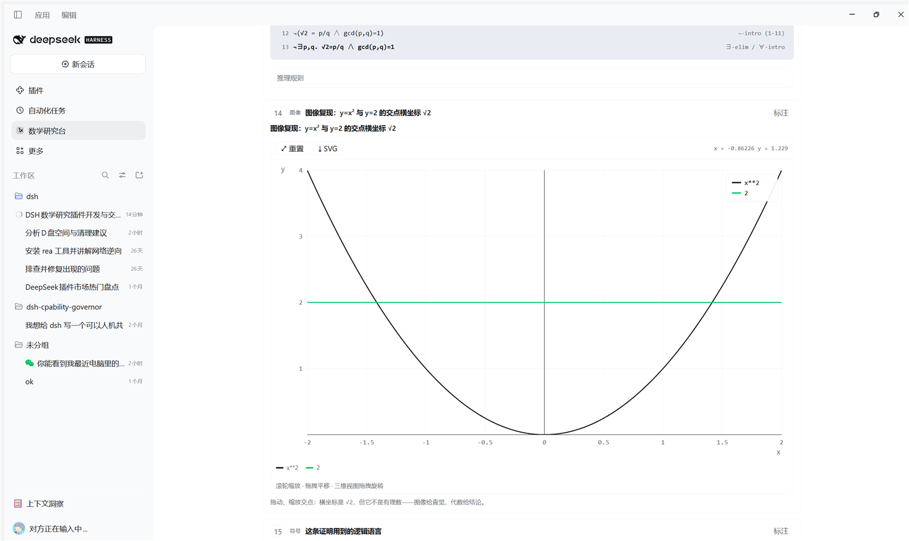
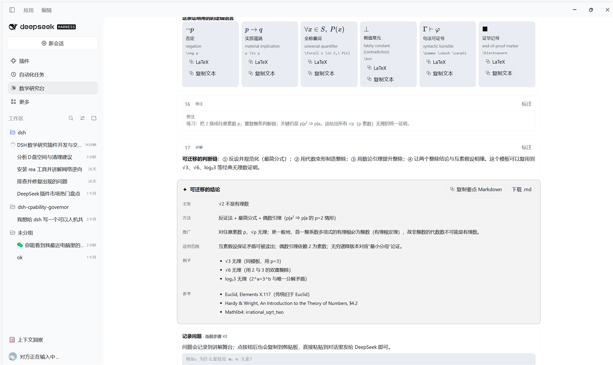

# MathLab · 数学研究台

**MathLab** 是 DeepSeek Harness（DSH）的高等数学研究工具插件，不是数学知识介绍页，而是一台可以真正"算"的工具台：

- **符号计算**：SymPy 驱动的化简、展开、因式分解、求导、积分、极限、级数、求和、解方程、解微分方程、矩阵分解等；
- **抽象代数**：置换群运算、群的 Cayley 表 / 中心 / 共轭类 / 子群格（Hasse 图）/ 正规子群 / 商群 / Sylow / 同态检验，有限域 GF(pⁿ) 运算与乘法表，ℤ/nℤ 单位群与零因子；
- **范畴论**：有限范畴的范畴公理校验（结合律 / 单位律）、函子与自然变换检验、交换图校验、Set 中的积 / 余积 / 等化子 / 余等化子 / 拉回 / 推出等泛性质构造；
- **数理逻辑**：命题逻辑真值表 / CNF / DNF、经典自然演绎证明搜索（Fitch 风格 + 证明树）、一阶逻辑有界模型检验、归结、模态逻辑 K/T/S4/S5 有界 Kripke 检验；
- **Lean 4**：自动探测本地 Lean 工具链，在线检查 Lean 4 代码、读取诊断、浏览内置 Mathlib 片段库与 Mathlib 记号表；未安装 Lean 时给出明确安装指引而不是假装成功；
- **研究生几何与拓扑**：单纯复形同调群（含挠部）、图的基群、Christoffel 符号 / Riemann / Ricci / 标量曲率、外微分与 Lie 括号；
- **图像**：二维函数 / 参数 / 极坐标 / 隐函数等值线 / 向量场绘图，三维曲面线框旋转，交换图、子群格、Cayley 图、真值表与证明树全部为矢量渲染；
- **符号词典**：按 13 个数学领域整理的双语符号表（LaTeX / Unicode / Lean / SymPy 对照），支持搜索与复制；
- **例子库**：可直接载入执行的研究生级例题（分析、代数、范畴、逻辑、拓扑、绘图等）。

## 安装

- 从 GitHub 源码安装（推荐，固定提交见发布页）：

```bash
dsh plugin --profile desktop add github:FileXego/dsh-mathlab
```

- npm 包名为 `dsh-mathlab`（发布后可用 `dsh plugin --profile desktop add dsh-mathlab`）。
- 安装后重启/重载 DSH；侧边栏出现 **数学研究台**。

## 使用方式

### 在 Web 界面

侧边栏出现 **数学研究台** 图标（Σ 与交换图母题），点击进入面板。面板包含：

| 标签页 | 内容 |
| --- | --- |
| 讲解 | **与 AI 互动的数学课堂**：智能体把思路树、逐步判断、形式证明、可交互图像/交换图、逻辑符号与可泛化的结论推到这块"黑板"上；你可以逐步查看、标注、提问、导出 Markdown |
| 计算 | 符号表达式的化简 / 求导 / 积分 / 极限 / 级数 / 解方程 / 解 ODE 等 |
| 线代 | 矩阵行列式、逆、秩、RREF、特征值、零空间、SVD、线性方程组 |
| 代数 | 置换计算器、群探索器、有限域 GF(pⁿ)、ℤ/nℤ |
| 范畴 | 有限范畴编辑器与交换图渲染、函子 / 自然变换、极限构造 |
| 逻辑 | 真值表、自然演绎证明树、FOL / 模态有界检验 |
| Lean | Lean 4 状态、代码检查、Mathlib 片段库 |
| 拓扑 | 同调群、基群、曲率张量 |
| 绘图 | 2D/3D/隐函数/向量场，可下载 SVG |
| 符号 | 双语符号词典 |
| 例子 | 例题库，一键载入 |

### 和 AI 一起讲数学（讲解舞台 / Live Stage）

这是本插件最重要的交互方式：当你在对话里让我"讲清楚/证明/推导/展示"一个数学问题时，我会把讲解推到 **讲解舞台**，而不是只回一段文字。舞台有三种显示位置，用对话输入框上方的 **「右侧 / 内嵌 / 关闭」开关** 任选其一，互斥显示，并记住选择：

- **右侧（推荐，原生分栏）**：注册进 DSH 自带的右侧 Sidebar（不是浮层），聊天与讲解真正并排；右侧 Sidebar 的「开始」页里有独立的 **讲解** 按钮，也可以从讲解条点「右侧」打开/聚焦。新讲解会按你的选择自动打开对应侧。
- **顶部分体菜单（右侧与内嵌共用）**：**状态、上一步/下一步、跟随讲解/自由查看、讲解/过程轨迹、复制/导出、步骤条、缩放**固定在顶部（sticky），正文、标注、问题独立滚动——往下翻讲解时，步进控件始终在，随时可以跳回任意步，不需要再用滚轮找回去。
- **缩放**：顶栏右侧的 `A− / 100% / A+ / ⟲` 缩放正文、公式与图像（75%–175%，记住比例）；配合已有的图像缩放/平移，密集公式和函数图都能看清。
- **插件选项**：「讲解」页顶部有两个**独立开关**——`下侧栏`（输入框上方的讲解条/内嵌）和`右侧栏`（DSH 原生右侧 Sidebar 的讲解 tab）；默认都开启，可只留一个，也可都关。关掉一侧不影响另一侧，关掉右侧会同时移除右侧 tab 与「开始」页入口。
- **内嵌**：讲解条下方就地展开，适合不想占用右侧栏时。
- **关闭**：只保留一行讲解条（仍可随时切回），把屏幕完全让给代码/对话。

舞台上可以同时看到：

- **思路树**：先给整体策略（目标 → 子目标 → 方法分支 → 结论），让推导不是"跳步"；
- **判断卡**：每一步显式写出"目标 / 假设 / 已得 / 所用规则 / 检验 / 矛盾 / 结论"以及理由，这正是证明过程中的逻辑判断；
- **形式证明**：Fitch 自然演绎逐步展开，可切换证明树；
- **图像与结构**：交互式函数图、曲面、向量场、交换图、子群格、Cayley 表——都能缩放/旋转/悬停；
- **逻辑符号与连接**：符号 chip 可点击，高亮所有使用该符号的步骤；符号块提供「符号 → 步骤」连接清单和**符号—步骤连接图**，点符号/步骤互相跳转；
- **可迁移结论卡**：把这次推导提炼成命题、方法、一般化、适用范围与参考，一键导出 Markdown 公开分享；
- **过程轨迹**：我调用过的每个 `mathlab` / `mathlab_plot` / `mathlab_lean` 运算都自动记录（参数、结果、摘要），便于核对"我真的算了"，而不是编造。

**划词提问 → 直接送到对话**：在讲解里的任意段落选中文字，会出现「划词提问」浮标；写下问题后点「记录并发送到对话」，问题（带引用）会记录到当前会话的舞台，并**自动放进对话输入框**，你直接按发送即可。每块的「标注」也保留，我下一轮回答前会先读取你的标注与问题。示例说法：

- "用 MathLab 给我讲清楚为什么 √2 不是有理数，把每一步判断和图像放上讲解台"
- "证明这个范畴拉回是积，并用交换图展示，最后提炼成可复用的方法卡"
- "把这个积分过程做成讲解，包含换元思路树和函数图像，导出分享"
- "P vs NP 的等价表述能弱化到多少层？用极限语言分析，放到右侧讲解台"

平台协议见 [docs/STAGE.md](docs/STAGE.md)。实际界面：













### 作为智能体工具

安装后，智能体获得以下工具（与面板共用同一套运算层）：

- `mathlab` — 运行任意 `family.action` 运算（`calc.*`、`algebra.*`、`category.*`、`logic.*`、`topology.*`、`geometry.*`、`num.*`、`prob.*`、`opt.*`、`graph.analyze`、`plot.*`、`help`）；
- `mathlab_plot` — 生成绘图数据或 SVG 文件（可直接交付给用户查看）；
- `mathlab_lean` — Lean 工具链信息、代码检查、Mathlib 片段搜索；
- `mathlab_reference` — 符号词典 / 例题 / 片段 / 帮助检索；
- `mathlab_status` — 插件、Python 引擎与 Lean 就绪状态；
- `mathlab_stage` — 驱动"讲解舞台"：`present` 推送一整套讲解块，`append`/`update`/`focus` 随讲述推进，`get` 读取你的标注与问题，`export` 导出可分享的 Markdown。

示例：让智能体"用 MathLab 计算 ∫₀^∞ e^{-x²}dx，并画出被积函数"：

```
mathlab({ op: "calc.integrate", args: { expr: "exp(-x**2)", var: "x", lower: "0", upper: "oo" } })
mathlab_plot({ action: "svg", args: { kind: "explicit", expr: "exp(-x**2)", var: "x", range: [-3, 3] } })
```

## 依赖与就绪状态

| 依赖 | 作用 | 本机状态 |
| --- | --- | --- |
| Python 3 + SymPy / NumPy / SciPy / NetworkX | 全部计算与构造 | 插件自动探测（已找到 Python 3.13 + SymPy 1.14） |
| Lean 4（可选） | Lean 代码检查与 Mathlib | 未安装；`mathlab_status` / Lean 页会明确报告并给出安装指引 |
| KaTeX（随插件分发） | 公式排版 | 已内置（MIT，见 `NOTICE.md`） |

Python 不可用时，面板会显示"引擎启动中 / 引擎不可用"，`mathlab_status` 返回具体原因；不会静默失败。
自定义解释器路径：设置环境变量 `MATHLAB_PYTHON` 指向带有 SymPy 的 Python 可执行文件，然后重启 DSH。
Lean 安装（任选其一）：安装 [elan](https://github.com/leanprover/elan) 后执行 `elan toolchain install stable`，或把 `lean`/`lake` 加入 PATH；插件会自动探测。

## 架构

分层、宿主边界与“高内聚低耦合”说明见 [docs/ARCHITECTURE.md](docs/ARCHITECTURE.md)。

```
dsh-mathlab (bundle)
├─ index.js              Host 插件：注入 tools/webServer，挂载 MathLabService
├─ lib/
│  ├─ math-service.js    统一操作层（Host 自有数据 + Python 转发 + 讲解舞台）
│  ├─ stage-store.js     讲解舞台状态、块校验、过程轨迹与 Markdown 导出
│  ├─ python-bridge.js   常驻 Python worker 的 JSON 行协议、自动重启与超时
│  ├─ catalog.js         符号 / 例题 / Lean 片段数据
│  ├─ http-api.js        POST /mathlab/api 与 /mathlab/assets 静态资源
│  ├─ tools.js           6 个智能体工具（与面板同源操作）
│  ├─ fence.js           Host/Origin 浏览器信任栅栏（DNS rebinding 防护）
│  └─ define-tool.js     不依赖 DSH 包的 tool 定义构造器
├─ engine/mathlab_engine.py   全部数学运算（SymPy/SciPy/NetworkX）
├─ client-src/*.js      Web 面板源码（纯 JS + React.createElement）
├─ client.js            构建产物（单文件浏览器模块）
├─ data/*.json          符号表、例题、Lean 片段
└─ assets/katex/        内置 KaTeX
```

运算层只有一份：面板通过同源 HTTP JSON API 调用它，智能体通过工具调用同一批方法，因此 UI 与工具行为一致，错误信息同源。

## 开源参考与致谢

本插件在算法与接口设计上参考了以下开源项目（详见 `NOTICE.md`）：

- [SymPy](https://www.sympy.org/) — 符号计算内核（BSD-3-Clause）；
- [Mathlib4](https://github.com/leanprover-community/mathlib4) 与 [Lean 4](https://leanprover.github.io/) — Lean 片段与 Mathlib 记号（Apache-2.0）；
- [NetworkX](https://networkx.org/) — 图算法（BSD-3-Clause）；
- [SciPy](https://scipy.org/) / [NumPy](https://numpy.org/) — 数值计算（BSD-3-Clause）；
- [KaTeX](https://katex.org/) — 公式渲染，随插件分发（MIT）；
- DSH 自身的插件/插槽 API 与 `dsh-better-sidebar` 的路由栅栏实现（BSD-3-Clause / MIT，见 NOTICE）。

自然演绎规则集、有限范畴极限构造、模态有界检验、同调群 Smith 标准形等实现为本项目原创代码；符号表与例题为原创整理。

## 已知限制

- 一阶逻辑与模态逻辑只做**有界**判定（有限模型 / 有限世界），不是完备证明器；超界请求会明确说明。
- 群计算基于置换群表示，规模上限约 10⁴ 阶；子群格对较大群可能被限制。
- 绘图在浏览器端渲染；`mathlab_plot` 的 SVG 导出覆盖二维图，三维曲面可导出等轴测线框 SVG，同时以线框数据形式返回。
- Lean 检查默认在无项目环境运行；`import Mathlib` 需要本机已有 Mathlib 缓存/项目，插件会如实返回环境错误。
- 本插件不联网、不执行任意 Python；所有输入经受限解析器进入 SymPy。
- 讲解舞台**按会话隔离**：会话内讲解条显示当前会话的舞台，数学研究台主面板显示最近一次讲解；会话内用 SSE 推送 + ~900ms 轮询兜底。标注与问题保留在对应会话的舞台状态中，智能体下次回答前可读取。
- 讲解条挂在 `conversation.input.dock` 插槽上，带「右侧 / 内嵌 / 关闭」三态开关；右侧模式注册进 DSH 原生右侧 Sidebar（真正的分栏），内嵌模式占用输入框上方约 62vh，关闭模式只留一行状态条。三种模式互斥，选择会记住。
- 右侧原生 tab 与「开始」页的讲解按钮依赖 DSH 的 `sidebarRightTabs` / `sidebarRight` 客户端服务；宿主没有这两个服务时，插件会自动退回「内嵌」模式，不阻塞对话。
- 「发送到对话」通过会话草稿接口把带引用的问题放进输入框；如果宿主没有该接口，则退回复制到剪贴板。

## 许可

插件代码由本项目的原始实现构成。第三方组件许可见 `NOTICE.md`。
